<!-- Pixel panels are generated SVGs in /assets. -->

<a href="https://www.linkedin.com/in/abdul-ahad-137a122b2"></a>





<a href="https://github.com/abdulahad086/Stack8s_QA_automation"></a>
<a href="https://github.com/abdulahad086/Findsocial_automation"></a>
<a href="https://github.com/abdulahad086/beolivia-automation"></a>
 
<a href="https://github.com/abdulahad086/QA-Agent"></a>


<a href="https://github.com/abdulahad086/performance-testing-Sentinelops"></a>
<a href="https://github.com/abdulahad086/stack8s-ai-diagnose"></a>
<a href="https://github.com/abdulahad086/abdul-ahad-shiptrack"></a>
 
<a href="https://github.com/abdulahad086/abdul-ahads-sentinalops"></a>
<a href="https://github.com/abdulahad086/BugForge"></a>


<a href="https://github.com/abdulahad086/Songplace-Artist"></a>
<a href="https://github.com/abdulahad086/songplace-curator-ui"></a>
<a href="https://github.com/abdulahad086/songplace-landingpage-ui"></a>
 
<a href="https://github.com/abdulahad086/Find-Social-frontend"></a>




