<p align="center">
  
</p>

<p align="center">
  
  
  <a href="mailto:aahad8641@gmail.com"></a>
  <a href="https://www.linkedin.com/in/abdul-ahad-137a122b2"></a>
</p>

```txt
> PLAYER   Abdul Ahad · QA Engineer · Punjab, Pakistan
> CLASS    Bug hunter (manual)  +  builder (automation)
> STATUS   Open to remote QA / SDET roles
```

I explore products like a curious user and an attacker at the same time: access control, payments, sessions and edge cases, with a reproducible report for every defect.
Then I make sure it stays that way: Playwright + TypeScript suites, API and security checks, k6 load tests and CI pipelines that anyone on the team can run.

### `// abilities`

| | |
|---|---|
| 🔍 **Exploratory** | Roles & permissions · payments · sessions · edge cases |
| 🔒 **Security** | Access control · data exposure · auth & tokens · security headers |
| 🤖 **Automation** | Playwright · Cypress · pytest · Page Objects · CI pipelines |
| ↔️ **API** | Role-based checks · UI vs API · OAuth · integrations |
| ⚡ **Performance** | Load, stress, spike & soak · breaking points · web vitals |
| ☸️ **AI & infra** | AI products end to end · Kubernetes · my own AI QA agents |

### `// project cartridges`

**▸ Flagship**

| Cartridge | What it is |
|---|---|
| [**Stack8s QA**](https://github.com/abdulahad086/Stack8s_QA_automation) | Playwright + k6 framework for a multi-cloud Kubernetes control plane: UI, API, security and performance, in CI. |
| [**FindSocial**](https://github.com/abdulahad086/Findsocial_automation) | A Playwright suite a non-technical team runs with one command, with guard rails that keep it safe on production. |
| [**Be Olivia**](https://github.com/abdulahad086/beolivia-automation) | AI-designed rings: exploratory, security and accessibility testing, plus a pytest + Playwright regression suite. |
| [**QA Agent**](https://github.com/abdulahad086/QA-Agent) | Autonomous QA: Claude explores the app; Playwright, k6, Trivy and axe take the measurements. |
| **Songplace QA** | Music-promotion SaaS: exploratory, access-control, payment and session testing across artist, curator and admin apps. *Client data, kept private.* |

**▸ Side quests**

| Cartridge | What it is |
|---|---|
| [**k6 Perf Lab**](https://github.com/abdulahad086/performance-testing-Sentinelops) | Load, stress, spike, soak and ramp-up tests against a REST API. |
| [**K8s AI Diagnose**](https://github.com/abdulahad086/stack8s-ai-diagnose) | Ask why a pod is failing; get a root cause backed by real cluster evidence. |
| [**ShipTrack API**](https://github.com/abdulahad086/abdul-ahad-shiptrack) | Deployment tracker with rollbacks, API-key protected writes, pytest and CI. |
| [**SentinelOps API**](https://github.com/abdulahad086/abdul-ahads-sentinalops) | Incident tracker with a strict lifecycle and MTTR stats. |
| [**BugForge**](https://github.com/abdulahad086/BugForge) | A multi-tenant bug tracker: I built the tool QA lives in, from git push to Azure. |

**▸ UI projects**

| Cartridge | What it is |
|---|---|
| [**Songplace Artist**](https://github.com/abdulahad086/Songplace-Artist) · [demo](https://songplace-artist-live.vercel.app) | Connect Spotify, build a campaign, pay and track it, in one music-first app. |
| [**Songplace Curator**](https://github.com/abdulahad086/songplace-curator-ui) · [demo](https://songplace.vercel.app) | Playlists, scheduled tracks, campaigns, offers and a wallet. |
| [**Songplace Landing**](https://github.com/abdulahad086/songplace-landingpage-ui) | A two-sided landing page that flips between artists and curators. |
| [**FindSocial UI**](https://github.com/abdulahad086/Find-Social-frontend) · [demo](https://findsocial-redesign.vercel.app) | Music-industry discovery and outreach, redesigned as a “Print Room”. |

### `// how I test`

```txt
[1] RECON     map risk: money, data, auth and integrations
[2] EXPLORE   test as two users and as nobody
[3] AUTOMATE  stable flows → Playwright, API & security specs, k6 baselines in CI
[4] REPORT    one ticket per defect: steps, expected vs actual, evidence, then verify the fix
```

> A test only passes if a real assertion ran. Security details stay private until they’re fixed.

### `// inventory`

<p>
  
  
  
  
  
  
  
  
  <br />
  
  
  
  
  
  
  
  
</p>

### `// quest log`

- **QA Engineer · ePrecisio** — June 2026 – Present
- **QA Engineer · Uworx** — June 2025 – Aug 2025
- **BS Computer Science · FAST NUCES** — Aug 2022 – June 2026

### `// trophy shelf`

- 🏆 TestMu Conference 2026 · TestMu AI
- 🏆 Software Quality Engineering · Uworx Services

---

<p align="center"><sub>▸ found a bug? <a href="mailto:aahad8641@gmail.com">open a ticket</a> · expected ≠ actual · 200 OK ✓</sub></p>
